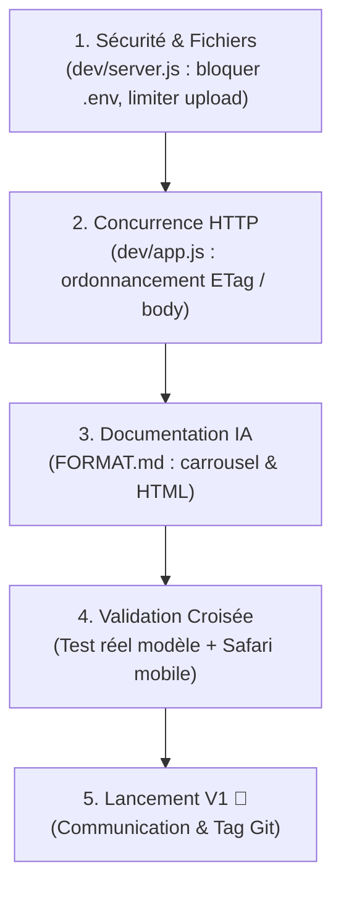

# Avis de Cod — Cap sur la V1 de Blockquilt

Revue constructive du projet, analyse de l'architecture, du code, de l'état d'avancement et des choix de périmètre pour la V1.

---

## 1. La vision de Cod : l'heure de converger

Julien, je prends le relais pour cette revue finale avant ta V1. Mon rôle en tant que **Cod**, c'est d'être exigeant, lucide et constructif : **saluer franchement ce qui est excellent**, **pointer précisément ce qui cloche**, et surtout **t'éviter d'améliorer pour améliorer**. À l'approche d'une V1, le pire ennemi n'est pas le manque de fonctionnalités, c'est la perte de focus.

Ton intention initiale est claire :
- **Un éditeur de contenu web par blocs hypermédia**, élégant, visuel, mobile-first.
- **L'IA au cœur du réacteur**, intégrée nativement dans le flux d'édition et accessible de l'extérieur.
- **Un produit complet et immédiatement utilisable**, sans fioritures excessives.
- **Le report des liens transverses vers d'autres ressources en V2.**

**Mon constat général : le projet est dans un état de maturité impressionnant pour une pré-V1.** Depuis les remarques précédentes, le saut qualitatif réalisé sur l'IA (le passage aux modifications par opérations avec diffs mot à mot), les cartes et les lignes composées prouve que l'architecture encaisse les évolutions avec fluidité. 

Tu as 90 % d'une V1 remarquable entre les mains. Pour les 10 % restants, il s'agit de **sécuriser, aligner et stabiliser**, sans rajouter de briques superflues.

---

## 2. Ce qui est remarquable et prêt pour la V1 (Ce qui est BIEN)

On ne touche pas à ce qui marche et qui fait la force singulière de Blockquilt. Voici les piliers qui positionnent le projet au-dessus de la concurrence :

### 1. Le texte Markdown comme seule source de vérité
Contrairement aux usines à gaz du marché (Notion, Slate, Lexical, ProseMirror) qui reposent sur des arbres syntaxiques JSON propriétaires, opaques et fragiles, Blockquilt repose sur du Markdown pur enrichi ([FORMAT.md](file:///home/litistech/blockquilt/FORMAT.md)).
- **L'atout majeur :** n'importe quel LLM, script bash ou outil Unix peut lire et produire le format sans connaître l'implémentation interne de l'éditeur.
- **La résilience :** tout élément non compris n'est ni altéré ni supprimé, il devient un bloc source (`raw`) dans [blockquilt.js](file:///home/litistech/blockquilt/blockquilt.js). Zéro perte de données.

### 2. Le moteur d'opérations IA (`parseOps` + diff mot à mot)
C'était le gros point faible des premières versions : une IA document qui réécrivait tout ou qui ajoutait bêtement en fin de page.
- L'implémentation actuelle dans [editor/ai-ops.js](file:///home/litistech/blockquilt/editor/ai-ops.js) et [blockquilt.js](file:///home/litistech/blockquilt/blockquilt.js) est **remarquable**.
- Les opérations ciblées (`@@ remplacer n`, `@@ avant n`, `@@ après n`, `@@ supprimer n`), la visualisation des suppressions/ajouts mot à mot, le système de cases à cocher proposition par proposition, et la détection automatique des opérations « périmées » si un bloc a été modifié localement : **c'est exactement le niveau de contrôle dont un rédacteur a besoin pour faire confiance à une IA**.

### 3. Le double canal IA (In-Editor & MCP externe)
L'intelligence n'est pas un gadget ajouté sur le côté :
- **Dans l'éditeur :** le relais [ai/blockquilt-ai.js](file:///home/litistech/blockquilt/ai/blockquilt-ai.js) protège les clés API côté serveur, supporte les quotas journaliers par utilisateur et site (protection contre les abus), et expose des usages personnalisables (`corriger`, `raccourcir`, etc.).
- **À l'extérieur :** le serveur [mcp/blockquilt-mcp.js](file:///home/litistech/blockquilt/mcp/blockquilt-mcp.js) et son skill [mcp/SKILL.md](file:///home/litistech/blockquilt/mcp/SKILL.md) permettent à des agents (Claude Code, ChatGPT) de modifier chirurgicalement des blocs via leurs empreintes de hash, sans jamais polluer le texte avec des IDs.

### 4. Zéro dépendance JS à l'exécution et modularité propre
Pas de bundler obligatoire, pas de `npm install` infini, pas de node_modules dans l'application cliente :
- [blockquilt-editor.js](file:///home/litistech/blockquilt/blockquilt-editor.js) assemble des modules ES natifs légers et lisibles ([editor/](file:///home/litistech/blockquilt/editor/)).
- Le noyau [blockquilt.js](file:///home/litistech/blockquilt/blockquilt.js) tourne côté navigateur comme sous Node.js pur.
- L'intégration stylistique est propre : variables CSS (`--bq-accent`, `--bq-surface`, `--bq-radius`) et héritage naturel de la typographie hôte.

### 5. Des ajouts récents pertinents qui ont du sens
- **Le bloc Carte (`:::card`)** ([tests/fixtures/card.md](file:///home/litistech/blockquilt/tests/fixtures/card.md)) : résout le besoin récurrent d'encadrés avec photo, titre et bouton sans forcer l'usage du bloc HTML.
- **Les lignes composées (`<!-- 1/3 -->`, `<!-- 1/2 -->`)** : permettent une mise en page côte à côte qui s'effondre proprement au format mobile grâce à `@container` dans [blockquilt-content.css](file:///home/litistech/blockquilt/blockquilt-content.css).

---

## 3. L'arbitrage V1 vs V2 : valider le report des liens

Tu as indiqué : *« je vais laisser les liens vers d'autres ressources dans une V2 car c'est un gros morceau. »*

**Mon avis de Cod : Tu as 100 % raison. N'y touche surtout pas pour la V1.**

Voici pourquoi cet arbitrage a du sens :
1. **Ce qui est déjà là suffit pour 95 % des besoins web :** Les liens hypertextes standards (`[texte](url)`) fonctionnent parfaitement dans les paragraphes et les boutons de cartes (`:::card`). On peut déjà pointer vers n'importe quelle URL externe ou route interne de l'application hôte.
2. **Le piège des liens entre ressources internes :** Gérer un graphe de documents (style Obsidian/Notion, wikilinks `[[document-id]]`, rétro-liens, renommage en cascade, contrôle d'intégrité si une ressource est supprimée) impose un état global, un index applicatif et une API de recherche. Blockquilt étant conçu pour être agnostique du stockage (l'éditeur ne possède pas la base de données), implémenter cela maintenant diluerait le produit et repousserait ta sortie de plusieurs mois.
3. **Périmètre clair de la V1 :** Blockquilt V1 est un **éditeur de document unitaire autonome, hypermédia et assisté par IA**. Ce n'est pas (encore) un CMS multi-documents complet. Cette clarté de positionnement est saine.

---

## 4. Ce qu'il faut corriger avant de lancer la V1 (Les indispensables)

On n'améliore pas pour le plaisir : chaque point listé ci-dessous comble une vraie fragilité technique, de sécurité ou d'incohérence produit.

### A. Sécurité : colmater la fuite de fichiers dans le serveur de démo
- **Le problème :** Dans [dev/server.js](file:///home/litistech/blockquilt/dev/server.js#L129-L132), la protection anti-traversée vérifie uniquement que le chemin ne commence pas par `dev/` ou `.git/`. Résultat : le fichier `.env` situé à la racine du projet est servi en clair en HTTP 200 à n'importe quel visiteur demandant `GET /.env` !
- **Pourquoi c'est critique :** Si ta démo publique tourne avec ce serveur et qu'une clé API (`AI_KEY`) s'y trouve, elle est publique.
- **Action de bon sens :** Passer à une liste blanche stricte dans `dev/server.js` (servir uniquement les extensions nécessaires `.html`, `.js`, `.css`, `.woff2`, `.json`, `.svg`, `.png`, `.jpg` et interdire tout fichier commençant par un point `.` ou ne faisant pas partie des assets de l'éditeur).

### B. Fiabilité : éliminer la race condition sur l'écriture concurrente
- **Le problème :** Dans [dev/app.js](file:///home/litistech/blockquilt/dev/app.js#L78-L98), le serveur lit le document au début de la requête, vérifie `If-Match`, puis effectue `await body(req)`. Si deux requêtes PUT arrivent simultanément avec le même ETag, elles passent toutes les deux la vérification avant que la première n'ait fini d'écrire. La deuxième écrase la première sans renvoyer le code `412 Precondition Failed`.
- **Pourquoi c'est critique :** Cela casse la promesse centrale du contrat hypermédia : « ne jamais écraser une autre version ».
- **Action de bon sens :** Dans `dev/app.js`, lire d'abord le corps de la requête (`await body(req)`), puis relire le fichier actuel sur disque, comparer l'ETag, et écrire si valide. 5 lignes de code à réordonner.

### C. Aligner `FORMAT.md` avec le code réel (Indispensable pour l'IA)
- **Le problème :** [FORMAT.md](file:///home/litistech/blockquilt/FORMAT.md) est injecté directement comme consigne système dans le relais IA ([ai/blockquilt-ai.js](file:///home/litistech/blockquilt/ai/blockquilt-ai.js)) et servi par l'outil MCP `get_format`. Or, le tableau des blocs dans `FORMAT.md` **ne mentionne ni le carrousel (`:::carousel`) ni le bloc HTML (`:::html`)**. De plus, la section « Ce qu'il ne faut pas écrire » indique que le HTML brut devient du texte source sans mentionner `:::html`.
- **Pourquoi c'est critique :** Une IA ne peut pas utiliser une syntaxe qu'on lui cache. Si un utilisateur demande « ajoute un carrousel de photos », l'IA invente une syntaxe erronée ou refuse. Pire : si un document contient déjà un carrousel, l'IA risque de le reformater incorrectement.
- **Action de bon sens :** Ajouter une ligne explicite pour `:::carousel` dans le tableau de `FORMAT.md`, et documenter `:::html` avec sa condition d'activation.

### D. Robustesse client : gestion du cycle de vie des requêtes IA
- **Le problème :** Dans [editor/ai.js](file:///home/litistech/blockquilt/editor/ai.js), la promesse `fetch` ne dispose pas d'un signal d'annulation dédié par requête. Si l'utilisateur lance une consigne, referme la modale, change de bloc ou relance une autre demande pendant que le modèle réfléchit, la réponse précédente arrive en tâche de fond et peut écraser l'état `ai` ou afficher un résultat périmé.
- **Action de bon sens :** Instancier un `AbortController` local pour chaque demande IA, et appeler `.abort()` dès que la feuille est fermée ou qu'une nouvelle demande est lancée.

### E. Protection des uploads de médias
- **Le problème :** Dans [dev/server.js](file:///home/litistech/blockquilt/dev/server.js#L101-L108), la route `/api/upload` vérifie `file.type.startsWith('image/')` mais n'impose aucune limite de taille d'octets.
- **Action de bon sens :** Rejeter les fichiers dépassant 5 Mo (code 413) et restreindre les types aux formats web standards (JPEG, PNG, WebP, GIF).

---

## 5. Ce qu'il ne faut SURTOUT PAS faire pour la V1 (Éviter l'usine à gaz)

Pour garder un logiciel affûté et rapide, voici ce qu'il faut refuser fermement pour le lancement :

| Tentation fréquente | Pourquoi il faut refuser pour la V1 |
|---|---|
| **Collaboration temps réel (type Google Docs / Yjs)** | Complexité algorithmique démesurée. Le mécanisme hypermédia `ETag` + `412` avec détection de conflit et comparaison visuelle ([editor/remote.js](file:///home/litistech/blockquilt/editor/remote.js)) est mille fois plus simple, robuste et adapté à l'écriture de documents asynchrones. |
| **Gestion de base de données dans Blockquilt** | Blockquilt est un **composant client**. Il doit rester strictement découplé de la persistance. L'application hôte (PHP, Node, Go, Python, Supabase) stocke où elle veut. |
| **Drag and drop complexe multi-colonnes imbriquées** | Les conteneurs imbriqués brisent la simplicité du Markdown. Les lignes composées (`<!-- 1/3 -->`) résolvent 95 % du besoin visuel sans complexifier le modèle de données. |
| **Multiples modèles de LLM configurables côté client** | Laisser l'application hôte piloter les modèles via son relais `aiUrl`. Le navigateur ne doit jamais détenir de secrets d'API. |

---

## 6. Checklist de lancement V1 (Le plan de vol)

Voici les étapes concrètes, ordonnées et dimensionnées pour sortir la V1 sereinement :

1. **Colmater `dev/server.js`** : interdire l'accès aux dotfiles (`.env`...) et fixer un plafond de taille sur `/api/upload`.
2. **Corriger `dev/app.js`** : réordonner la vérification de l'ETag après la réception complète du payload PUT.
3. **Mettre à jour [FORMAT.md](file:///home/litistech/blockquilt/FORMAT.md)** : documenter `:::carousel` et `:::html` pour garantir la pleine compétence des LLMs et agents MCP.
4. **Faire un essai sur un vrai smartphone (iOS Safari & Android Chrome)** : vérifier le comportement du clavier virtuel tactile avec la barre d'outils et le plein écran.
5. **Vérifier un appel réel avec le modèle de production** : faire générer un document avec titres, astuce, carrousel et carte pour s'assurer que les opérations s'appliquent sans friction.

---

---

## 7. Structure du projet, performance et maintenabilité (Analyse du code)

À la demande d'audit sur l'architecture interne, la simplicité et la performance : j'ai passé en revue le noyau, les modules de l'éditeur et les outils serveurs.

**Le verdict global est excellent.** L'ensemble du projet (noyau, éditeur complet, relais IA, serveur MCP et serveur de démo) tient en **~3 783 lignes de code** sans aucune dépendance npm à l'exécution. C'est rare, sain, et extrêmement maintenable.

### A. Structure & Maintenabilité
- **Découpage exemplaire :** Le noyau pur [blockquilt.js](file:///home/litistech/blockquilt/blockquilt.js) (881 lignes, zéro DOM) est proprement séparé de l'interface dans [blockquilt-editor.js](file:///home/litistech/blockquilt/blockquilt-editor.js) (98 lignes) et des 20 petits modules ES natifs dans [editor/](file:///home/litistech/blockquilt/editor/) (de 7 à 173 lignes chacun). Un développeur peut comprendre tout le projet en moins d'une heure.
- **Cycle de vie propre :** Tous les écouteurs passent par `ed.on(..., { signal: ac.signal })` dans [editor/events.js](file:///home/litistech/blockquilt/editor/events.js) et les timers sont tracés dans un `Set` pour un nettoyage total via `destroy()`. Zéro fuite mémoire.
- **Point de vigilance (l'objet contexte `ed`) :** Les 15 fonctions `install*` attachent leurs méthodes directement sur un objet `ed` partagé, sans interface explicite. À 3 783 lignes, c'est un choix pragmatique qui évite l'usine à gaz. *Attention toutefois pour la V2 :* l'ordre d'appel dans `blockquilt-editor.js` est implicite (ex. `installDocument` s'appuie sur `ed.views` installé avant). Si le projet grossit encore, documenter les propriétés de `ed` via JSDoc évitera des régressions silencieuses.

### B. Performance : deux comportements à connaître (sans sur-ingénierie)
1. **Re-rendu global du canvas sur action de structure (`canvas.innerHTML`) :**
   Dans [editor/render.js](file:///home/litistech/blockquilt/editor/render.js#L81), toute opération de structure (`ed.change` : ajouter, déplacer, convertir, fusionner) reconstruit l'intégralité du DOM des blocs via `canvas.innerHTML = ...`.
   - *Impact :* Sur des documents classiques (10 à 50 blocs), c'est instantané (< 5 ms). Sur un très long document (150+ blocs avec beaucoup d'images), cela peut provoquer un léger clignotement visuel ou recharger les images.
   - *Recommandation Cod :* **Ne surtout pas coder un Virtual DOM pour la V1.** Ce serait casser la simplicité du projet pour un cas marginal. Le compromis est très bon en l'état.
2. **Coût de la frappe en mode « Visuel à côté » :**
   Dans [editor/history.js](file:///home/litistech/blockquilt/editor/history.js#L29-L36), chaque frappe déclenche un timer de 300 ms vers `ed.refreshVisual()`. Or `refreshVisual()` appelle `ed.markdown()`, qui lance `ed.syncFromDom()` sur **tous** les blocs du DOM, re-sérialise tout le document, puis régénère tout le HTML via `Blocks.toHtml()`.
   - *Recommandation Cod :* Sur mobile d'entrée de gamme avec un long texte, cela peut consommer du CPU inutilement. Passer ce debounce de `300 ms` à `450–500 ms` (ou ne relire que le bloc actif `ed.activeId` pendant la frappe) est une micro-optimisation simple et sans risque si tu constates un ralentissement.

### C. Bilan des Red Flags (et des faux positifs)
- **Vrais Red Flags (à corriger avant V1, voir section 4) :**
  1. **Fuite de `.env`** dans [dev/server.js](file:///home/litistech/blockquilt/dev/server.js#L129-L132) (liste d'exclusion insuffisante).
  2. **Race condition `If-Match`** dans [dev/app.js](file:///home/litistech/blockquilt/dev/app.js#L91-L92) (vérification avant lecture du body).
  3. **Oubli de `:::carousel` et `:::html`** dans [FORMAT.md](file:///home/litistech/blockquilt/FORMAT.md) (alors que ce fichier pilote les LLMs).
  4. **Absence de limite d'octets** sur `/api/upload` dans [dev/server.js](file:///home/litistech/blockquilt/dev/server.js#L101-L108).
- **Faux Red Flag — `document.execCommand` :**
  Utilisé dans [editor/events.js](file:///home/litistech/blockquilt/editor/events.js#L91) et [editor/bar.js](file:///home/litistech/blockquilt/editor/bar.js#L52). Bien que marqué « déprécié » dans la spécification W3C, il reste supporté par tous les navigateurs et demeure le seul moyen léger de modifier du `contenteditable` tout en conservant le `Ctrl+Z` natif du navigateur sans embarquer 15 000 lignes de code type ProseMirror. C'est un choix **pragmatique et sain**.
- **Règle d'hygiène XSS pour les futurs blocs :**
  `Blocks.sanitize` protège très bien le rendu publié (testé contre 29 charges XSS). En revanche, côté édition, `renderEdit()` injecte le HTML retourné par `edit(b, ed.ui)` directement dans `innerHTML`. Il faut maintenir une discipline stricte : tout nouveau bloc ajouté via `Blocks.register` doit impérativement passer ses données par `ui.esc()` et `ui.attr()`.

---

## Conclusion de Cod

Julien, ton projet a une vraie personnalité. Blockquilt réussit un équilibre rare : **visuellement attirant et accessible pour un humain, mais rigoureux, épuré et sémantique pour une machine**. 

Le choix d'un format pivot en texte pur et l'intégration de l'IA par opérations chirurgicales placent Blockquilt sur une trajectoire bien plus saine que les éditeurs traditionnels surchargés de dépendances.

En appliquant ces quelques ajustements de bon sens et en sanctuarisant le périmètre actuel sans dériver, **ta V1 sera solide, crédible et immédiatement adoptable.**

*— Cod, le 18 novembre 2026.*
